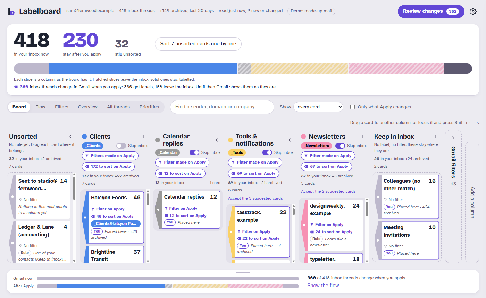
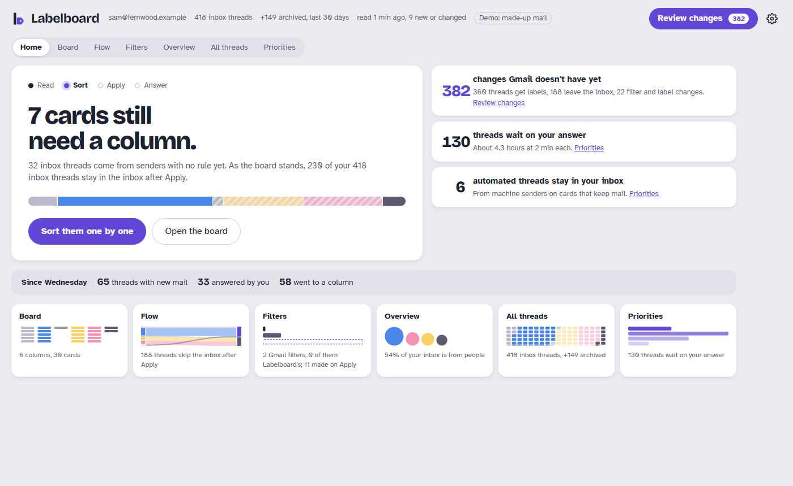
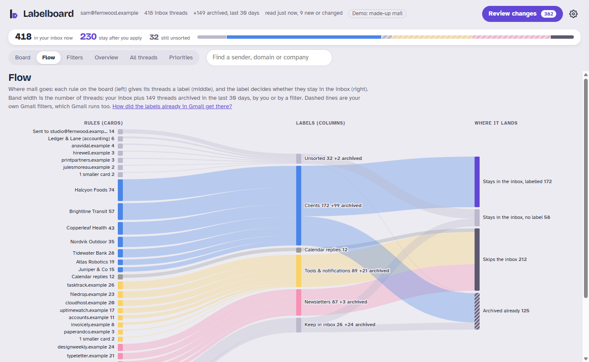
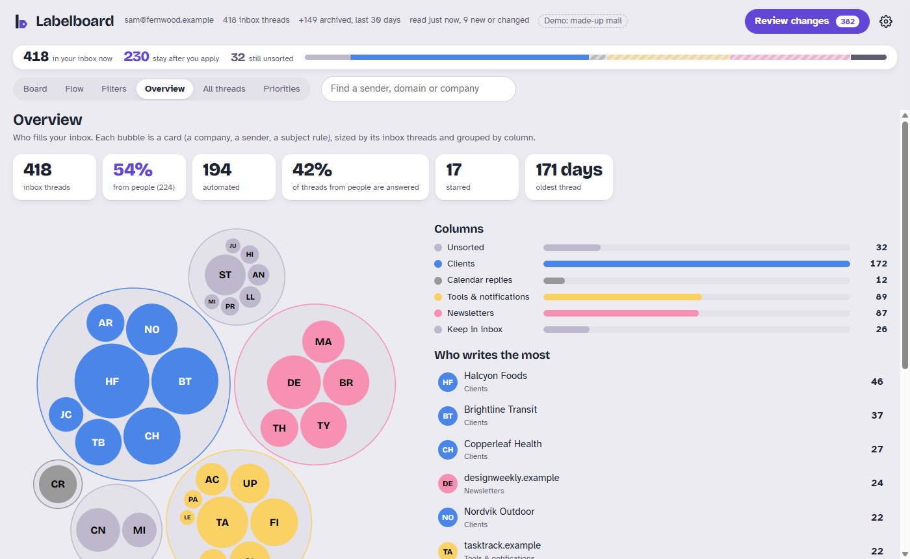
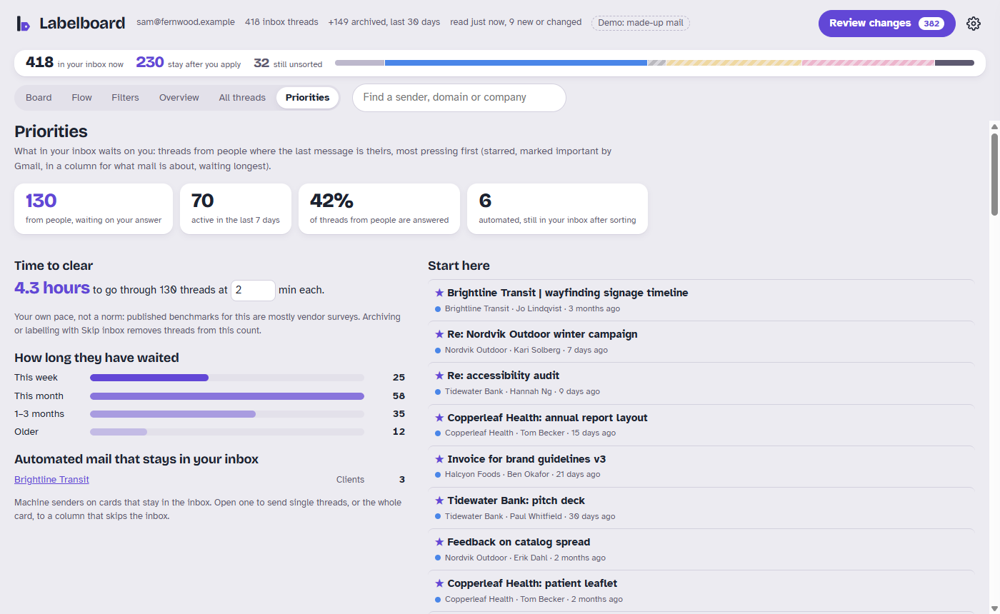
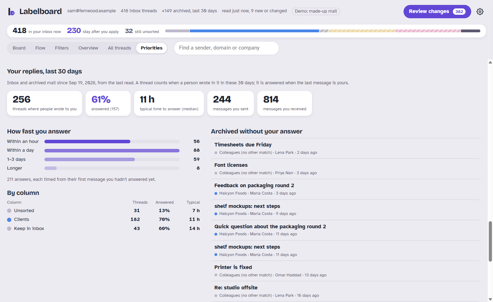

<p align="center"></p>

<h1 align="center">Labelboard for Gmail™</h1>

<p align="center"><b>Drag your inbox into shape.</b><br>
A board of cards that becomes your Gmail labels and filters. Runs in your own Google account.</p>

<p align="center">
  <a href="https://github.com/asfbr/labelboard/actions/workflows/test.yml"></a>
  <a href="LICENSE"></a>
  
  
  <a href="#private-by-design"></a>
</p>

---

Gmail filters are powerful and miserable to write. Labelboard reads your inbox, groups it into cards
(a client, a tool, a newsletter, a deal), and lets you sort those cards into columns by dragging them.
Each column is a label. When the board looks right, one click writes the labels and filters to Gmail
and sorts the mail already sitting in your inbox.

- **See it before it happens.** The top of the board shows your inbox now and after you apply: *1,200 in
  your inbox, 716 stay*. Every drag updates it. Every card and column says whether Gmail already has
  it sorted or what Apply still changes.
- **Sort by what mail is about, not who sent it.** A lawyer's email about a client lands with that
  client, not under "Lawyers".
- **Plain-word review.** Before anything touches Gmail, you read what will change and what won't.
- **Your filters stay yours.** The filters you already have show next to the board. Labelboard never
  edits or deletes one unless you hand it over.



<sub>Screenshots show a made-up mailbox (`npm run demo`): every name and address in them is invented.</sub>

## See your inbox from every side

Labelboard opens on Home, and next to the board are five views of the same decisions:

| View | What it answers |
|---|---|
| **Home** | What now? The next step, big (sort the new senders, apply, answer what waits on you), the rest of what waits beside it, what came in since you last looked, and a door to each view. Settings → Look picks how it looks (What now, Gallery or Labels) and whether Labelboard opens on it. |
| **Flow** | Where does mail go? Every rule, the label it gives, and whether the mail stays in the inbox, as one diagram, including the last 30 days of mail that already skipped it. Your own Gmail filters drawn alongside. |
| **Filters** | How did the labels already on your mail get there? By a filter, by hand, or not at all because the mail came before the filter. Then each filter day by day, so you see when it started catching mail and what it would have caught before. |
| **Overview** | Who fills your inbox? Bubbles per sender or company, grouped by column, plus who writes the most and your inbox threads by month of their last message. |
| **All threads** | Every inbox thread as one square, on one screen. Hover to read it, click to open its card. Color by column or by age. |
| **Priorities** | What waits on you? Threads from people where the last message is theirs, most pressing first, how long they've waited, the time to clear them at your pace, and the automated mail still cluttering the inbox. Below, your replies over the last 30 days: how many threads you answered, how fast, per column, and what you archived without answering. |



| Flow | Overview |
|---|---|
|  |  |
| **Priorities** | **Your replies, last 30 days** |
|  |  |

## Private by design

- **It runs as your own Apps Script.** No server, no Google Cloud project, no third party. The code
  runs inside your Google account and only you can open it.
- **Metadata only.** It reads who wrote, who was copied, the subject, the labels, the dates, Gmail's
  short snippet and whether there is an attachment. It never opens message bodies. It reads your inbox
  plus the last 30 days of archived and sent mail, so mail your filters keep out of the inbox shows on
  the board too (off in one click in Priorities).
- **Nothing happens without Apply.** Reading, dragging and every view are read-only. Apply creates
  labels and filters and sorts inbox threads. It never sends mail, and deletes only what you set a card
  to delete. The one thing that runs while you're away is the hourly *Archive it later*, only while a
  card asks for it.
- **Open source.** Every line that touches your mail is in this repo.

## Get started

You need a Gmail account and Node.js, about 20 minutes, most of it the first read of your inbox.

```sh
npm install -g @google/clasp && clasp login
npm run build && cd dist
clasp create --type webapp --title Labelboard --rootDir . && clasp push && clasp deploy -d "first version"
```

Then open the web app address, pick a preset and read your inbox. **[The full guide](docs/INSTALL.md)**
covers every Google screen on the way (the Apps Script API switch, the "unverified app" warning, several
signed-in accounts) and how to update or remove it.

## How sorting works

1. **Read** the inbox, and the last 30 days of mail that left it, into a snapshot (sender, recipients,
   subject, labels). Later reads only fetch threads that changed.
2. **Cards.** Each thread is claimed by one card, a rule you can drag. What a thread is *about* wins over
   who is on it: a client or project named in the subject or taking part (a *topic*), then a topic in a
   process with a signal word, subject patterns, group addresses, counterparties, and only then the
   accountant, agency or lawyer copied on it. Last, the sender's domain or address.
3. **Suggestions.** Each card starts in a column picked from your existing labels, a contacts file, an
   optional AI read, or newsletter and notification patterns. Unclear ones wait in *Unsorted*.
4. **Board.** Drag cards between columns (or focus one and press Shift + ← →). Each column has a label
   color and a *Skip inbox* switch.
5. **Review and apply.** Labels are created or recolored, filters are compared with the ones Labelboard
   owns, then the threads already in your inbox get their labels (one batch call per label). Labels
   Labelboard created come off inbox threads whose card moved; labels you made never do.

Gmail runs *every* matching filter, and the board does the same: a thread gets every label whose rule
matches, and leaves the inbox if any of them skips the inbox.

### Your existing filters

They show in their own lane with what they match in your inbox and where they overlap the board.
*Adopt* one to hand it to Labelboard (then you can change or remove it on the board); *Hand it back*
returns it untouched. A filter Labelboard made that you later edit or delete in Gmail is flagged, not
quietly written again.

## Presets and settings

The first run asks for a preset: `basic` (Clients, Calendar, Tools, Newsletters) or `investor`
(portfolio, dealflow, M&A with sale processes, other deals, funds, data rooms). Switch any time under
*Settings → Import and export*: your identity, topics and the cards you placed are kept. Everything is
editable in *Settings*: columns, your addresses and group addresses, subject rules, topics, processes.

Column flags: `topics` (contacts filed here are what mail is about), `newTopics` (the AI read may add
topics here), `automated` (machine mail). `config.processes` lists processes like a sale:
`{ bucket, title, folder?, words[], from[] }`; with a `folder`, each topic's label goes inside it
(`_M&A/Deals/Acme`). A contact filed under a sub-label of its own (`_M&A/Advisors`) goes there when no
topic is named.

### Contacts file (optional)

A JSON list that teaches the board who is who, imported with *Import a file…* in Settings → Import and export. The same
item takes an AI read and a settings file, so a setup tuned in the local preview moves over in one step.

```json
[{ "match": "domain", "value": "acme.com", "bucket": "clients", "name": "Acme", "sublabel": "Acme" },
 { "match": "email", "value": "ceo@gmail.com", "bucket": "clients", "name": "Acme" },
 { "match": "process", "value": "Acme", "bucket": "legal", "name": "Acme" }]
```

A contact's role comes from its column (`topics` or not); `"role": "counterparty"` marks a party whose
mail is about one thing even when no topic is named (a buyer, a recruiter). Domains shared by unrelated
senders (gmail.com…) never count as a company, and automated senders never count as a person.

### Ask an AI (optional)

Labelboard itself never sends your mail anywhere. Two ways to bring an AI in, both ending in a file you
import, so nothing changes until you look at it on the board:

- **Any AI.** *Settings → Ask an AI → Download the brief* makes one file: the cards you haven't placed,
  with up to 3 senders, 3 subjects and the first line of the newest email each, and your columns. Paste
  it into Claude, ChatGPT or any AI you trust, then paste its answer back in the same place.
- **Claude with your Gmail.** Copy [`skills/labelboard`](skills/labelboard/SKILL.md) to
  `~/.claude/skills/` and connect Gmail in Claude. Claude places cards from the brief, opening threads
  where a card is unclear, and can read every thread (many small Haiku readers, one Sonnet to
  reconcile) for the AI read below. It never changes Gmail itself.

Either way, what goes into the brief or the read (senders, subjects, snippets) reaches that AI.

Under the hood, rules only see addresses and subjects. An AI read of each thread (subject + snippet) lands in the
settings as `threadVotes: { "<threadId>": { "b": bucket, "t": topic|null, "c": "high"|"medium"|"low", "w": why } }`.
A voted topic then claims the thread first, machine mail drops counterparty claims, and votes become
card suggestions. For mail already in the inbox, a *high* vote that disagrees with its card moves that
one email; the card drawer shows each move and lets you undo it or move any email yourself. Future mail
always follows the cards' rules.

A review goes further and places cards: `{ "labelboard": "claude-review", "cards": { "<card key>": { "bucket", "why" } } }`,
imported like any file. Those cards carry a *Claude* pill until you keep or move them, and a card you
placed is never overwritten. `node dev/review.mjs list` prints the cards to review from a local snapshot.

Settings can ship with a deploy: `node dev/build.mjs --bake settings.json`, then `clasp push`. The script
takes a baked file once and keeps the cards you placed.

## Develop

```sh
npm test                                   # rule engine, sync and views (Node, no dependencies)
node dev/serve.mjs ~/.labelboard 8765       # the board on a local snapshot, Gmail untouched
node dev/ingest-mcp.mjs <pages> <labels.json> <out.json> <you@domain>   # snapshot from Gmail MCP pages
node dev/ai-read.mjs prep|merge [dataDir]   # the AI read in parts, then one file to import (skills/labelboard)
```

`src/rules.js` is the only place rules live; the board, the tests and the server all load it.
`src/insights.js` computes the views. No bundler and no npm dependencies: `dev/build.mjs` inlines
everything into the one HTML page Apps Script serves. Design notes: `docs/ARCHITECTURE.md`,
`docs/DESIGN.md`.

## License

MIT. Gmail is a trademark of Google LLC. Labelboard is not made or endorsed by Google.
